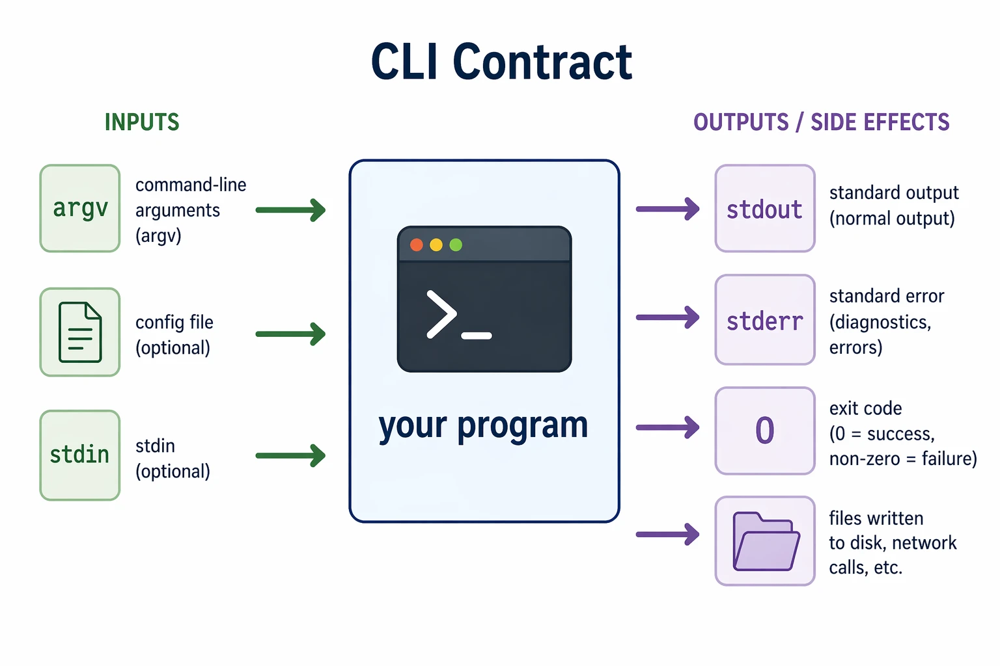
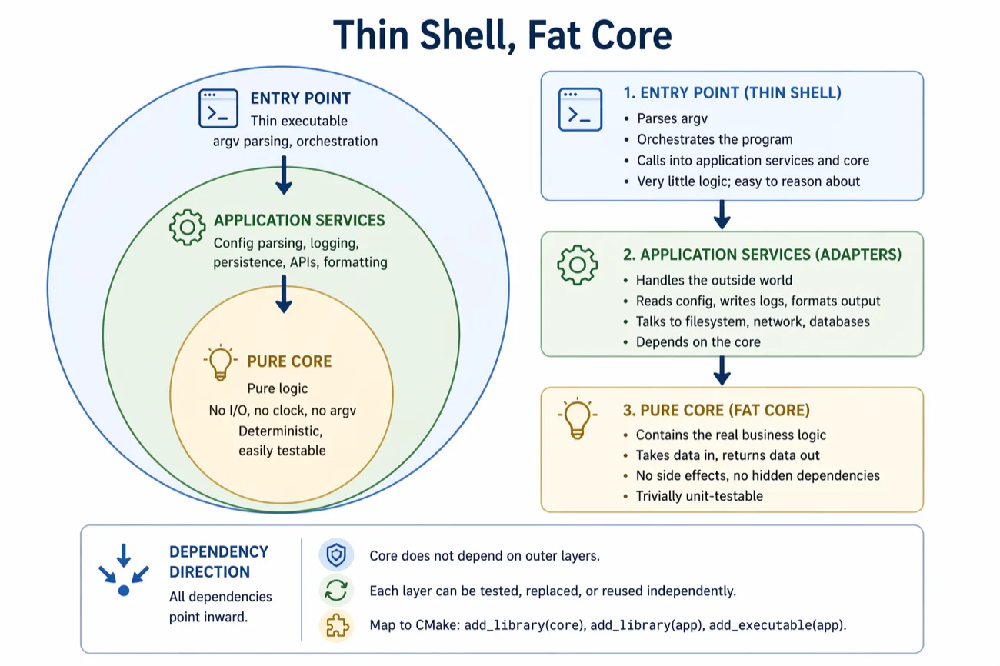

# C++ CLI Tooling

The tools in this course are CLIs. The same executable should run by hand, from
a script, or in CI without changing the core logic.

## Start with the CLI contract

A command-line tool has a small interface to the outside world. It has a
handful of input channels (`argv`, config files, `stdin`)
and a few output channels (`stdout`, `stderr`, an exit code), plus whatever side
effects it has on disk or the network.



Keeping that contract small is what makes a CLI easy to script, call from CI, or
pipe into another program.

Use this configuration order:

1. defaults in the program;
2. values from a config file; and
3. command-line flags for this run.

Later sources override earlier ones. Whatever order you pick, don't let it
depend on which parsing function happened to run last.

## CMake is a graph of targets

A CMake project is a graph. Libraries and executables are targets; calls such
as `target_link_libraries` add dependency edges. CMake uses the graph to work
out build order and carry usage requirements to consumers.


Use `PUBLIC` when a dependency is part of a target's interface and its consumers
also need that dependency's usage requirements. Use `PRIVATE` when only the
target's implementation needs it. In the diagram, `core` exposes its Boost
dependency while `utils` keeps Boost internal.

A minimal example:

```cmake
cmake_minimum_required(VERSION 3.15)
project(my_app CXX)
set(CMAKE_CXX_STANDARD 17)

add_library(core src/core.cpp)
target_include_directories(core PUBLIC include)

add_executable(my_app src/main.cpp)
target_link_libraries(my_app PRIVATE core)
```

## Prefer package targets

`find_package` asks CMake to locate a dependency. When the package provides an
imported target, link that target instead of manually collecting include paths
and `-l` flags:

```cmake
find_package(Boost REQUIRED COMPONENTS program_options)

target_link_libraries(my_app PRIVATE Boost::program_options)
```

`Boost::program_options` carries the usage requirements supplied by the package.
Not every older CMake package exposes a target this cleanly, but use one when it
does.

`REQUIRED` makes a missing dependency fail during configuration. I prefer that
to letting the build continue toward a harder-to-read compiler or linker error.

## Keep I/O at the edges



Parse `argv` and config files in the executable, resolve their precedence, and
pass a typed configuration into the library. If you use Boost.Program_options,
keep its `variables_map` at that boundary.

The logic core should take ordinary values and return ordinary results instead
of reaching for the filesystem, clock, network, or command line. An application
layer can handle files and external services when those do not belong in the
executable itself.

Make the core a library target and the CLI a small executable target. Tests can
call the library without faking `argv` or scraping terminal output.

## Report failures

Three conventions cover most small tools:

- Exit `0` on success and non-zero on failure.
- Send normal output to `stdout` and diagnostics to `stderr`.
- Say what failed and include the relevant file, option, or value.

Don't catch an exception just to print `"Error"`. Give the person running the
tool a next step.

```cpp
int main(int argc, char** argv) {
    try {
        // ... real work here
        return 0;
    } catch (const std::exception& e) {
        std::cerr << "error: " << e.what() << "\n";
        return 1;
    }
}
```

## Assignment

Apply these ideas in the **Satellite Temperature Monitor**, a small C++/CMake
simulation that reads two redundant sensors, averages them, and flags
out-of-range temperatures. The target names, flags, and output files are fixed
so an autograder can check the same contract on every push.

Go to
[gtcloudrobotics/satellite-temperature-monitor](https://github.com/gtcloudrobotics/satellite-temperature-monitor),
click **Use this template**, then clone your copy. Run `python3 run_tests.py`
locally before you push; GitHub Actions runs the same checks.
