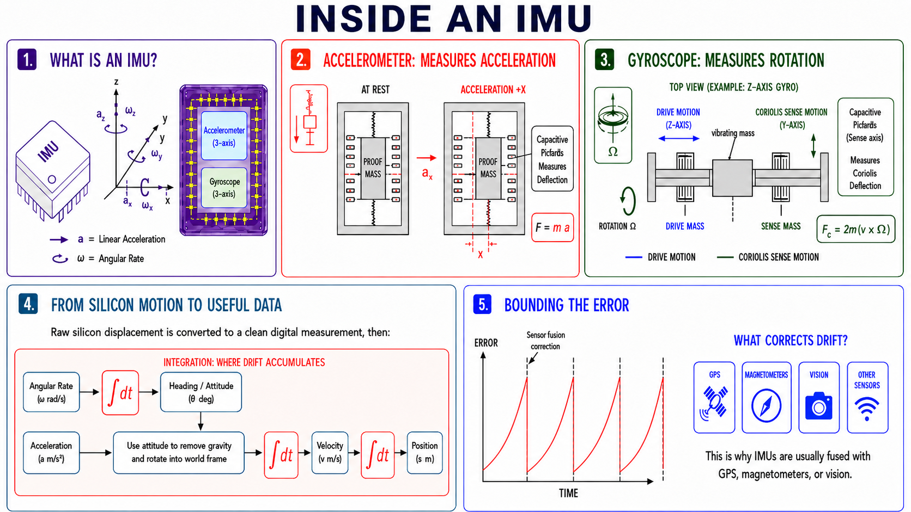
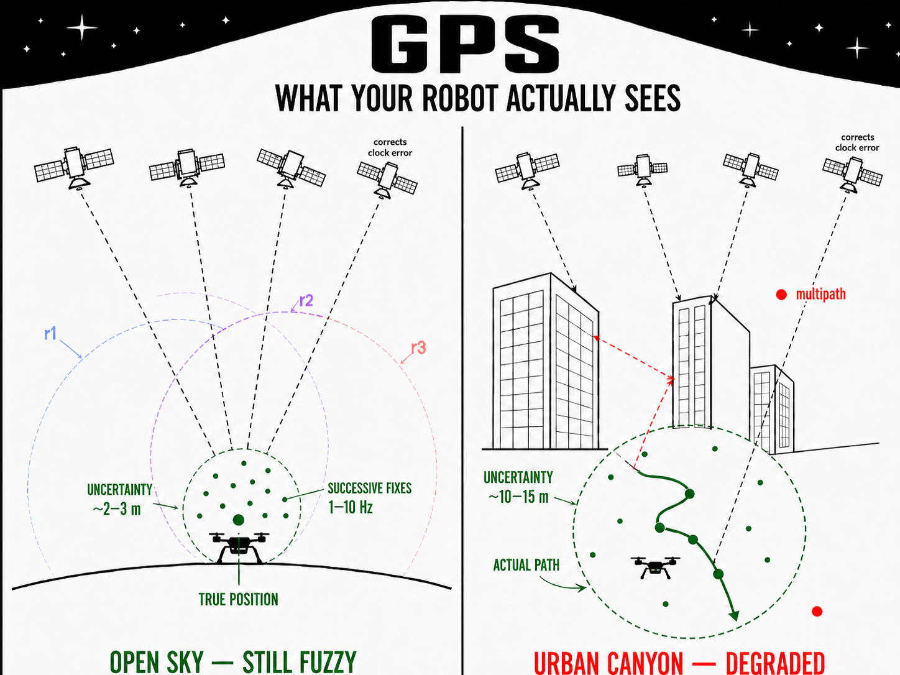

# Hardware Basics

Underneath the software you write is a stack of physical hardware, and every layer is adversarial. Sensors approximate the world with bias and delay. Motors turn current into torque but lie about position. Buses move bytes until they don't. Compute platforms trade capability for determinism in ways that only matter under real load. And the power supply, nominally stable on a meter, sags the moment the motors pull hard. Each section covers one layer: what it actually does, at what rate, and how it fools you.

---

## 1. Sensors Are Approximations With A Bias

A sensor never measures the world. It measures a physical proxy — a voltage, a time of flight, a count of photons — and reports a number that is *correlated* with the quantity you wanted. Every sensor has noise, every sensor has bias, and every sensor has a regime where the proxy breaks down entirely.

| Sensor | Measures | Typical Rate | How It Fools You |
| --- | --- | --- | --- |
| IMU (accel + gyro) | Specific force, angular rate | 100 Hz – 1 kHz | Bias drifts with temperature; gravity reads as 9.8 m/s² of "acceleration" forever |
| GPS | Position, velocity from satellite ranging | 1–20 Hz | Multipath in urban/indoor environments; useless under canopy or roof |
| Lidar | Time-of-flight ranges across a scan | 10–20 Hz | Points within one frame were acquired at *different* times during the scan |
| Radar | Range and velocity from FMCW returns | 10–20 Hz | Poor lateral resolution; ghost returns from multipath |
| Camera | Photons → pixel array | 30–120 fps | Rolling shutter skews fast motion; exposure time is part of the timestamp |
| Wheel encoder | Quadrature pulse counts | 1+ kHz | Counts wheel rotations, not robot motion — slip and tire wear corrupt the integration |

**IMU.** Inside a modern IMU sit two MEMS structures, each smaller than a grain of rice. The accelerometer is a proof mass on silicon springs: acceleration deflects the mass, and capacitive pickoffs measure that deflection. The gyroscope exploits the Coriolis effect on a vibrating resonator to measure rotation. Neither device measures motion directly; both measure tiny mechanical displacements that get integrated into motion estimates, and that integration is the trap. Every IMU has a bias, a consistent offset even at rest, that compounds per second into heading and position error. A gyro that reads cleanly on the bench may read 0.1°/s in flight; integrated over a minute, that's 6° of heading error the state estimator cannot distinguish from real rotation. Temperature shifts the bias. Power-cycling gives you a different bias. Something that reads clean on the bench will be noticeably wrong 90 seconds into a flight.

**GPS.** Each GPS satellite carries an atomic clock and continuously broadcasts its position and the current time at the speed of light. A receiver listens to multiple satellites at once, measures the propagation delay from each, and trilaterates its own position. Four satellites is the minimum: three for 3D position plus one more to solve for the receiver's local clock offset. The signals are extremely faint by the time they reach the ground, which is why GPS dies the moment you're indoors, in a tunnel, or in an urban canyon where building reflections produce multipath errors that look like real range data.

!!! warning "Lesson page in construction"
    lidar, radar, camera, motors, buses, and compute sections in pg

