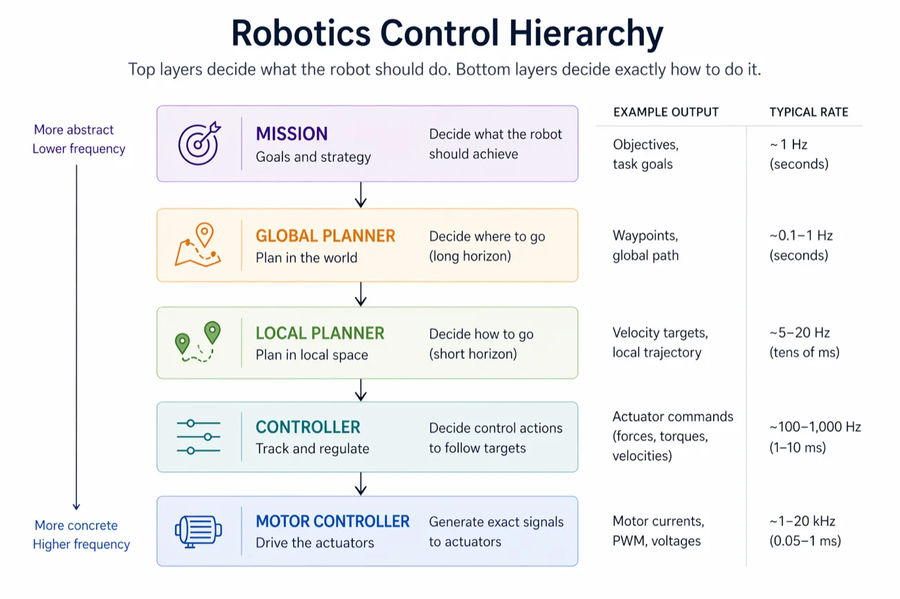
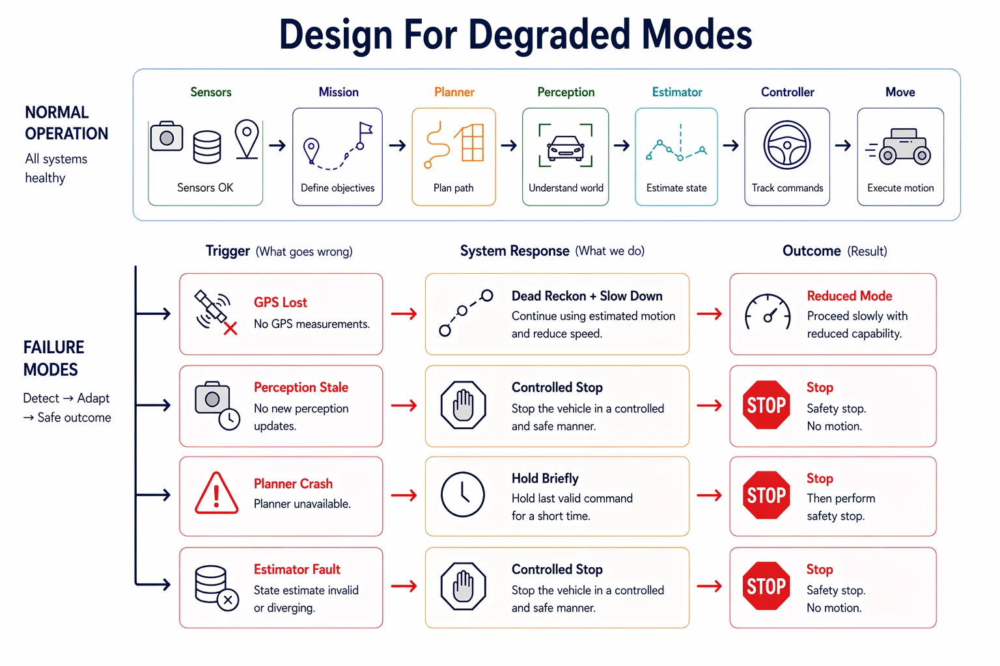

# System Design

A robotics stack is a bunch of services doing different jobs and passing data
around. This page covers how they connect, why they run at different rates, and
what happens when data stops arriving.

## Robots run at different rates

A robot is rarely one big sense-think-act loop, even if you believe VLMs are the
future. Mission logic may update every second, a planner a few times per second,
perception when a sensor delivers a frame, and control much faster. The exact
numbers depend on the vehicle and the job. Longer-horizon decisions can usually
run more slowly than the loops responding directly to motion.



A fast loop should not wait for a slower one to produce something new. One
option is to store only the latest pose. Perception replaces it when new data
arrives, and the controller reads the newest complete pose available. The
timestamp says how old that pose is.

```cpp
struct StampedPose { Pose value; double t_sec; };
LatestValue<StampedPose> latest_pose;  // stores the newest complete pose

void perception_loop() {
    while (running) {
        latest_pose.store({run_perception(), now()});
        wait_for_next_frame();
    }
}

void controller_loop() {
    while (running) {
        StampedPose s = latest_pose.load();
        if (now() - s.t_sec > pose_timeout) enter_safe_mode();
        else send_command(compute(s.value));
        sleep_until_next_control_tick();
    }
}
```

`LatestValue` is a placeholder for code that prevents the controller from
reading a pose halfway through an update. `pose_timeout` is the oldest pose the
controller will accept.

## Pass results, not implementation details

Perception extracts information from sensor data. Estimation combines
information over time into a state. Planning decides where to go, and control
generates the commands that make the vehicle follow the plan.

Perception should give the planner detected objects or free space, not access to
a camera driver. The planner should give the controller a trajectory, not its
map internals.

```text
Good:
camera data -> perception -> detected objects -> planner -> trajectory -> controller

Bad:
planner -> camera driver
controller -> map internals
UI -> actuators
```

The first passes each step's result forward. The second makes one service depend
on how another does its job.

The same problem appears in a function signature:

```python
# Clean — depends on a typed world model.
def plan(world: WorldModel, goal: Goal) -> Trajectory: ...

# Leaky — depends on three layers the planner should never know about.
def plan(world, camera_driver, imu_serial_port, ros_node): ...
```

## Handle late and missing data

Message rate, delivery delay, and age are different. A sensor can publish at 20
Hz while a backed-up processing queue delivers old measurements. Set a maximum
age for each input and decide what the receiving service does after that
timeout.



Suppose a delivery robot's depth camera freezes. Perception stops updating free
space. The planner can use its last path for a short timeout while the
controller keeps running. After the timeout, the planner or a separate
supervisor commands a stop. The design should say how long the timeout is and
which service sends that command.
