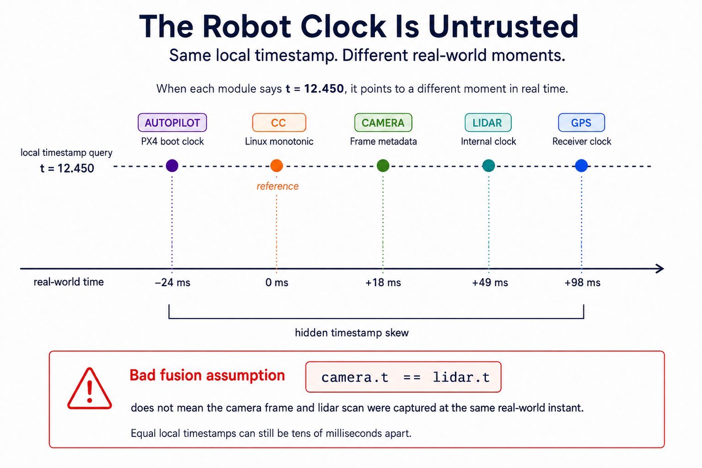
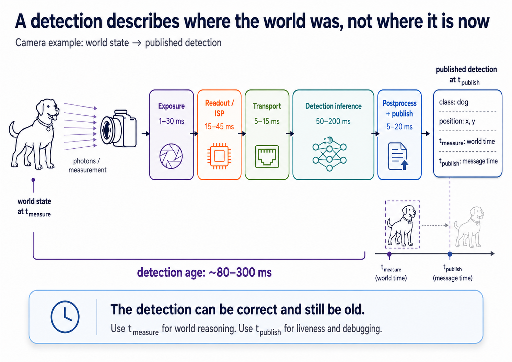

# Time Alignment

Every sensor reading on a robot is a pair: *what* was measured, and *when*. The "what" gets all the calibration attention. The "when" is where the silent bugs live.

If two modules disagree on what "now" means by even a few tens of milliseconds, the data they produce no longer describes the same world. Downstream fusion and control still produce confident outputs about a world that never existed. When it's wrong, the failures show up everywhere else.

## 1. One Robot, Many Clocks

There is no "the robot's clock." A typical platform has four or five independent clocks: the embedded controller's, the mission computer's, each camera's, the lidar's, and more. Each starts at a different instant and drifts at its own rate.

The classic failure: two modules both stamp their data with what they each call `t = 12.450`, and a fusion node treats those as the same instant. The lidar and camera detections might be 80 ms apart in reality. The perception stack happily projects lidar points into a camera frame from a different moment of the maneuver. The fused output looks confident. It's wrong.

The fix is to designate one canonical clock and convert every message to it at the sensor adapter. Downstream code only ever sees canonical time.

Clock offsets aren't static. A typical oscillator drifts 20 microseconds per second; that's a millisecond per minute and tens of milliseconds within an hour. A boot-time calibration is already wrong before the mission ends. Reconciliation has to be continuous. MAVLink `TIMESYNC` and PTP both handle this with a ping-pong exchange: time how long a probe takes to round-trip and you have a continuously-updated offset that tracks drift without touching the clocks.

## 2. Two Timestamps, Not One

Even after the clocks agree, the timestamp on a message rarely says what you think. A camera detection at canonical `t = 12.450` doesn't mean "an object was at this location at t = 12.450." It means "we finished computing a detection at t = 12.450, about a world that existed some time earlier."

Every sensor pipeline costs time at every stage: exposure, readout, ISP, transfer, inference. A detection arriving right now describes a world that existed 80–300 ms ago, depending on the model and pipeline. Even with perfectly reconciled clocks, a controller that takes the timestamp at face value is reacting to where an obstacle *was*, not where it *is*.

Two timestamps go on every message:

- **`t_measure`** — when the world was in the state this message describes. Exposure midpoint for a camera; start-of-scan for a lidar; fix epoch for GPS. Everything downstream operates on this stamp.
- **`t_publish`** — when this message was emitted. Useful for liveness checks and network debugging. Not for reasoning about where things are.

A trajectory computed on a cloud server when the robot was at pose A may arrive at the robot when it's already at pose B. `computed_at` is `t_measure` for a plan: it tells the controller exactly how old the plan is, and how far the robot has moved since it was made.

## 3. Rate Decoupling and Freshness

The same [shared-slot pattern from system design](system-design.md#1-a-robot-is-not-one-loop) applies: a fast consumer reads the latest value without blocking; the slow producer writes whenever it has something new.

**Freshness is measured from `t_measure`, not from when the message arrived.** A trajectory that sat in a network buffer for 200 ms arrives looking new to the subscriber; the receive time looks fine. But the plan was already stale when it arrived. Checking `now - received_time` misses that entirely. Checking `now - t_measure` catches it.

Stale data should fail visibly. A controller that drives on a 500 ms-old plan is dangerous; one that detects staleness and stops is predictable and recoverable. The robot starts moving again the moment fresh data arrives.

**The slowest stage sets the effective reaction envelope, not the fastest.** Doubling your controller rate from 200 Hz to 1 kHz saves ~4 ms. Halving your detection model's inference from 200 ms to 100 ms saves 100 ms. The leverage is always in the dominant stage, which is almost never the controller. Before optimizing anything, budget the whole pipeline: perception latency + transport + planner + controller + actuator. The sum is what the robot can actually guarantee.

## Assignment

**TurtleBot Remote Command**: perception and planning run in the cloud, the controller runs on the robot, and between them is a network bridge with configurable latency, jitter, and packet loss. Implement the three nodes. Get the freshness and rate logic right and the robot navigates safely when the network degrades; get it wrong and it drives into a wall.

Go to [gtcloudrobotics/turtlebot-remote-command](https://github.com/gtcloudrobotics/turtlebot-remote-command), click **Use this template** to make your own copy, then clone and push. The autograder runs on every push and you'll see pass/fail in the Actions tab. Enrolled GT students just send me your GitHub username at the start of the semester so I can match your repo to your grade.
